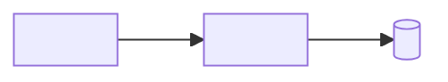

# How the iln programs connect

<!-- Story 1.4: the dependency graph, written as tables. Every row is "A relates to B" with evidence and a confidence.
     The Jira agent follows these tables in both directions for impact analysis, and confirms each step with a code search.
     Large application: split into parts in specs/iln/connections/<part>.md (one per module, or online and batch),
     each with these same headings and "part" in the header. -->

## 1. Online: transactions to programs (AC 39, 40)

| Transaction | First program | Links to (LINK) | Transfers to (XCTL) | Screens (maps) | Files (CICS FILE → dataset) | Evidence | Confidence |
|---|---|---|---|---|---|---|---|
| <TRAN> | <PROGRAM> | <PROGRAM, ...> | <PROGRAM, ...> | <MAPSET/MAP> | <FILE → DSNAME> | <path:line> | <high> |

## 2. Batch: jobs to steps to programs (AC 41, 42)

| Job | Step | Runs (program or PROC) | Condition | Reads | Writes | Evidence | Confidence |
|---|---|---|---|---|---|---|---|
| <JOB> | <STEP> | <PROGRAM / PROC> | <COND / IF> | <datasets> | <datasets> | <path:line> | <high> |

## 3. Program calls (AC 37)

| Caller | Calls | How | Evidence | Confidence |
|---|---|---|---|---|
| <PROGRAM> | <PROGRAM> | <static CALL / CALL through a variable / CICS LINK / XCTL> | <path:line> | <high / medium for a variable> |

<!-- Calls through a variable: list the possible targets if the code shows them (VALUE or MOVE literals), otherwise "target unknown"
     and an entry in section 8. -->

## 4. Programs to copybooks, files and datasets (AC 38, 44)

| Program | Uses | Kind | Access | Evidence | Confidence |
|---|---|---|---|---|---|
| <PROGRAM> | <COPYBOOK / VSAM cluster / dataset / table> | <copybook / VSAM / sequential / DB2> | <copy / read / write / update / delete> | <path:line> | <high> |

## 5. Job order (AC 43)

| Job | Runs after | How we know | Evidence | Confidence |
|---|---|---|---|---|
| <JOB> | <JOB> | <scheduler definition / shared dataset: one writes, the other reads (inferred)> | <path:line> | <high / medium if inferred> |

## 6. Interfaces with other systems (AC 45)

| Direction | Partner | Through | Programs / jobs | Evidence | Confidence |
|---|---|---|---|---|---|
| <in / out> | <system> | <file transfer / MQ / DB2 / API> | <names> | <path:line> | <high> |

## 7. Diagram

<!-- A small picture of the main flow (at most about 40 boxes); GitLab draws Mermaid diagrams in Markdown.
     The tables above are the record; the diagram is for people. -->

## 8. Gaps

| ID | Gap | Evidence | Question for the SME |
|---|---|---|---|
| G-<part>-01 | <component referenced but not found / call target unknown / schedule information missing> | <path:line> | <question> |
